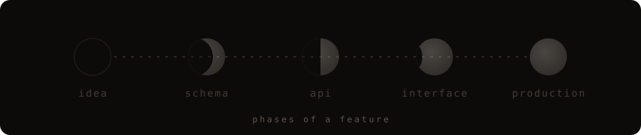

<div align="center">



<br>


<br><br>



<br><br>


<br><br>

```
› a stale ui is worse than a slow one.
› propose the api contract before someone hands you one.
› frameworks change. the job doesn't: make it boring, make it reliable, ship it.
```

<br>


&nbsp;


<br><br>

<sub><i>the dark side of the moon is just the part without tests.</i></sub>

<br><br>

<a href="https://linkedin.com/in/volodymyr-pieknyi"><sub>linkedin</sub></a> &nbsp;·&nbsp; <sub>lviv</sub>

</div>
